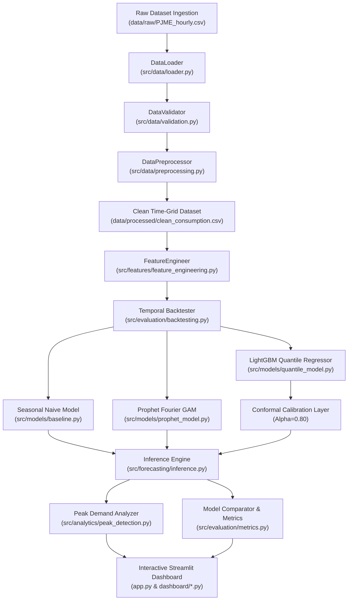

# System Architecture & Design Specification

**Project:** Intelligent Energy Demand Forecasting and Probabilistic Peak Load Prediction  
**System Architecture Lead:** Member 6 (System Integration & Architecture Lead)

---

## 1. Architectural Philosophy

The application follows a **Domain-Driven, Decoupled Modular Architecture** separating data engineering, feature transformation, machine learning inference, uncertainty quantification, evaluation diagnostics, and presentation.

```
energy-demand-forecaster/
├── app.py                     # Streamlit User Interface Dispatcher
├── config/settings.yaml       # Central Parameter Repository
├── data/
│   ├── raw/                   # Raw unmodified datasets (PJME_hourly.csv)
│   └── processed/             # Cleaned, continuous hourly datasets
├── src/
│   ├── data/                  # Ingestion, validation, preprocessing (Member 1)
│   ├── features/              # Non-leaking temporal feature engineering (Member 2)
│   ├── models/                # Baseline, Prophet, LightGBM, Quantiles (Members 3 & 4)
│   ├── forecasting/           # Multi-horizon strategies & inference engine (Member 4)
│   ├── evaluation/            # Metrics, backtesting, model comparison (Member 5)
│   ├── analytics/             # Peak demand detection & overload alerts (Member 5)
│   └── utils/                 # Configuration, logging, persistence helpers
├── dashboard/                 # Modular Streamlit page renderers (Member 6)
├── tests/                     # Automated Pytest suite (21 unit/integration tests)
└── docs/                      # University academic defense documentation
```

---

## 2. Component Interaction & Data Flow



---

## 3. Core Software Engineering Patterns

1. **Strategy Pattern:** Multi-step forecasting dynamically supports **Direct Multi-Horizon** and **Recursive Multi-Step** strategies via common interfaces.
2. **Facade Pattern:** `EnergyForecastingEngine` encapsulates feature engineering, temporal lag updating, recursive inference, and ground-truth merging behind a single high-level API.
3. **Immutability & Pure Functions:** Feature transformations return new DataFrames without mutating historical input data in-place.
4. **Defensive Serialization:** Model states, fitted preprocessors, and benchmark evaluation outputs are serialized via `joblib` and `JSON` with schema versioning.

